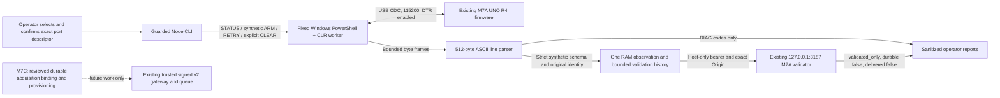

# M7B — UNO R4 WiFi USB Serial bridge

18 November 2026. **M7B is implemented and ready for review. A real USB-to-localhost synthetic validation flow was observed on the owner-confirmed COM7.** ARM bytes arrived from the board automatically, the existing validator accepted the acquisition, and RETRY produced an identical-acquisition duplicate. Both responses remained **validated only, not durable and not delivered**. No real RFID scan, new firmware upload, attendance mutation or durable Arduino gateway ingestion was performed. The full dependency audit remains failed as detailed below; this is not production acceptance.

## Baseline and scope

Fetched `main` and `origin/main` matched **`490d36442a0a5bafd67583521669c2767777887a`**, the latest M7A handoff. M7A firmware/validator/CLI, M3 acquisition/enrollment contracts, immutable signed v2 ingress/transport/assignment validation, durable queue and M6 security freeze were inspected. The unrelated doc 45 edit, `CLAUDE.md` and `review/` are preserved and excluded. The developer `.env.local` was not opened, copied, modified, renamed or hashed.

Work uses the existing owned isolated QA checkout `C:/Users/Om/AppData/Local/Temp/schovera-m7a-qa-b5bad848` and its approved private loopback test configuration. The older user rehearsal is not adopted or cleaned. No dependencies, lockfile, migration, application UI, attendance/communication writer, v2 signing/provisioning or durable queue implementation changes belong to M7B. Private ignored evidence **E** is `.local/schovera-manual-demo/m7b-20261118/`; physical result JSON is under the owned QA `.local/m7b/` and copied into E for review.

## Architecture



There is **no current arrow from this bridge to the durable gateway**. No Supabase client, raw-card mapping, service-role impersonation, signing key, competing durable queue or automatic classroom status exists in this bridge. M7A firmware and the validator's security/session rules remain unchanged. Firmware still retains only one synthetic observation in RAM. The host also holds at most one current observation in RAM, not an outbox, and validates the receiver's response before reporting success.

## Windows installation and port ownership

- Use the approved local QA setup and installed project lockfile. Tested with Node **22.18.0**, Windows PowerShell **5.1** and its built-in .NET SerialPort/C# facilities. No npm SerialPort package, new driver or Arduino library is installed by M7B. This bridge is Windows-only.
- The worker uses a fixed local script with a fixed executable/argument array, `shell:false`, an OS environment allowlist and a closed command grammar. Serial text is never evaluated as PowerShell or a shell command.
- Worker execution requests **RemoteSigned for that child process only**. No global execution-policy or enterprise Group Policy change is made. If local policy blocks it, stop and consult the administrator; do not bypass policy or use arbitrary downloaded scripts.
- Close Arduino IDE's **Serial Monitor tab/pane** and **Serial Plotter window**, plus any other terminal owning the selected port. Leave the sketch/IDE open if desired. The bridge never kills Arduino IDE, another terminal or a competing process.
- Keep HW-126/RC522 disconnected; no unsoldered-header wiring, Nano, Raspberry Pi or physical RFID work is included.

`list` enumerates present COM names and bounded USB/FTDIBUS registry descriptors without opening them. Other virtual/Bluetooth ports can be listed with unavailable metadata and are refused for opening. Windows CIM inspection timed out on this machine; the shipped discovery deliberately uses the non-CIM path. COM7 was observed here; **it is not the default or a permanent assumption**. The full selected PnP instance descriptor is rechecked immediately before open. A USB descriptor/port name is an OS claim, not cryptographic authentication or proof of board identity.

The port is opened at fixed **115200, 8-N-1**, no handshake, DTR enabled and RTS disabled. The official installed UNO R4 core's `SerialUSB.cpp` gates reads/writes on its connected/DTR state. No 1200-baud bootloader-touch sequence or upload is performed. Opening/closing USB can affect a device's state; do not assume RAM survives a reconnect or power interruption.

## Exact local PowerShell workflow

These commands are for this laptop's approved isolated QA path. On another machine, first establish its own approved QA configuration; do not copy production env files or assume this temporary directory exists there. The normal project checkout's private configuration is not used for these tests.

Terminal 1 — start the existing validator:

```powershell
Set-Location 'C:\Users\Om\AppData\Local\Temp\schovera-m7a-qa-b5bad848'
$env:SCHOVERA_ARDUINO_TEST_MODE = 'synthetic'
npm run arduino:dry-run
```

Retain its printed **privateHostAccessFile path** privately. Its token is read only by the PC; never paste that file/token into Serial Monitor, firmware, a screenshot or Git. The receiver is fixed to `http://127.0.0.1:3187/v1/dry-run`. No LAN bind/URL/proxy/redirect option is supported.

Terminal 2 — discover, inspect and explicitly confirm the intended board:

```powershell
Set-Location 'C:\Users\Om\AppData\Local\Temp\schovera-m7a-qa-b5bad848'
$env:SCHOVERA_ARDUINO_TEST_MODE = 'synthetic'
npm run arduino:serial -- list

# Parse the same CLI's JSON without npm's banner, then choose explicitly.
$inventory = node --env-file=.env.test.local scripts/arduino-local/serial-cli.mjs list | ConvertFrom-Json
$chosenPort = Read-Host 'Type the intended board COM port from the fresh list'
$chosen = @($inventory.ports | Where-Object { $_.port -ceq $chosenPort })
if ($chosen.Count -ne 1 -or !$chosen[0].pnpId) { throw 'No unique usable descriptor; stop' }
$chosen[0] | Format-List port,name,pnpId,manufacturer
if ((Read-Host 'Confirm this is your UNO R4 by typing the same COM port again') -cne $chosenPort) { throw 'Selection not confirmed' }
$privateAccessPath = Read-Host 'Paste only the privateHostAccessFile path printed by terminal 1'
node --env-file=.env.test.local scripts/arduino-local/serial-cli.mjs connect --port $chosenPort --confirm-pnp-id $chosen[0].pnpId --access $privateAccessPath
```

`--port`, exact `--confirm-pnp-id` and the owned private access path are required; unknown options, public targets, arbitrary scripts and raw Serial commands are not accepted. No port is silently selected or substituted. The access file must be an ordinary non-linked file in this QA checkout's `.local/arduino-dry-run/<session UUID>/host-access.json`, with the exact approved endpoint and schema.

At the bridge's operator prompt:

```text
status
arm
retry
```

Wait for each result. `arm` generates one fresh fictional UUID/sequence/UTC timestamp on the PC and sends a safe M7A ARM command. It does not fabricate an incoming Serial observation. A `synthetic_serial_received` report requires actual incoming bytes through the selected port. A `validated_only` report requires the matching localhost HTTP response. Repeated ARM while awaiting bytes sends the exact original command; a different ARM while an observation is pending is refused. `retry` asks the firmware to emit its cached bytes again.

Expected first response: `validated_only`, `duplicate:false`, `durable:false`, `destinationDelivered:false`. Expected retry: same acquisition ID, `duplicate:true`, both delivery flags still false. Then explicitly discard **only that fictional RAM observation**, substituting its reported UUID:

```text
discard <synthetic acquisition UUID>
close
```

`discard` sends matching CLEAR; the host waits for the firmware's discard diagnostic before clearing its matching current RAM state. It is not a database delete or durable acknowledgement. Stop terminal 1's owned receiver with Ctrl+C after closing the bridge. Its ignored session files remain private; no database cleanup is needed for USB validation alone.

## Output meaning and recovery

| Report / situation | Meaning and required action |
|---|---|
| `diagnostic` | Recognized DIAG mapped to a fixed code. Unknown diagnostics are replaced by a generic code, never printed raw. Boot/status is not acquisition or delivery proof. |
| `synthetic_arm_command_sent` | Host wrote a command to its pipe; physical receipt is not yet proven. |
| `synthetic_serial_received` | Strictly valid synthetic incoming Serial observation in the configured session; no student/card identity is established. |
| `validated_only` | Existing localhost validator returned the matching synthetic acquisition and safe false delivery flags; no SQLite receipt or PostgreSQL event exists from this bridge. |
| Durable accepted / delivered | **Not produced by M7B.** These require future reviewed M7C use of the existing trusted gateway's separate real receipts. |
| `validation_unconfirmed` | Body remains in host RAM while the process lives. Restore the same receiver/session and use `retry-validation` to resend those exact received bytes, or `retry` to request firmware replay. No new UUID/time is assigned. |
| `stale_synthetic_session` | Firmware still holds an earlier receiver's fictional observation. It is not forwarded or rebound. Close to preserve it, or explicitly `discard` its reported synthetic UUID before arming a new test. |
| `arm_refused` / no pending message | Firmware's current RAM state differs from the PC's expectation. Inspect status/retry; do not pretend work was saved. An actual reboot can lose firmware pending state. |
| USB unplug, permission denial or busy port | Stop reading/close ownership and report the failure. Close the other owner yourself. After replug, run `list` and explicitly select/confirm again, even if the COM number looks unchanged. No auto-reopen or renumber fallback. |
| Host/receiver restart or session expiry | M7A's 15-minute session/history and token are independent of firmware RAM. A new receiver creates a new session; old messages are refused rather than rebound. Do not edit access files or timestamps to make replay appear accepted. |

Framing is bounded to 512 ASCII bytes; LF and terminal CRLF are accepted, including split chunks. Embedded CR, NUL, non-ASCII, oversized and malformed lines are refused and framing recovers at newline. Schema rejects raw UID/student/unknown fields, physical-kind claims, unsupported versions, changed replay and sequence reuse. Bounded session history reports gaps/out-of-order without rewriting identity/time. Overlapping arrivals cannot build an unbounded host backlog: only the current RAM observation is eligible for forwarding; competing work must remain/retry at its source. Logs expose only bounded codes, fictional acquisition IDs/counters and explicit false delivery flags, not raw bodies, keys or arbitrary DIAG text.

There is **no end-to-end exactly-once or reboot durability guarantee**. Host memory, firmware RAM and validator history can all be lost. A disconnect that removes board power can lose its pending observation. The existing gateway's durability guarantees apply only to actual captured gateway rows, not this validation-only bridge.

## Observed versus pending

| Item | Evidence category / result |
|---|---|
| Earlier IDE upload, LED, manual STATUS/ARM/RETRY and separate PC requests | Owner-reported before M7B; not reclassified as independent Codex upload/electrical evidence |
| Present COM7 and descriptor selection | Observed through native discovery; owner separately confirmed intended UNO R4, closed monitors and disconnected RC522 |
| Live STATUS and automatically received JSON | **Observed on actual COM7** through the shipped worker/core and then the operator CLI |
| ARM → localhost validation → RETRY duplicate | **Observed with actual incoming Serial bytes**; identity retained, first nonduplicate and then duplicate, both not durable/delivered |
| Old pending example | Board correctly refused new ARM; exact earlier example was preserved until separate owner approval, then matching CLEAR was observed |
| Concurrent port ownership | Actual second open of selected COM7 was denied while the first bridge owned it; no competing process was terminated |
| Normal CLI close | Observed; owned port/worker and receiver closed after synthetic cleanup |
| Partial lines, malformed/oversized/NUL/UID/student input, replay conflicts, sequence order, lost response, expiry, wrong Origin and receiver restart | Automated fake-stream/real-loopback tests, not physical fault injection |
| USB unplug/replug/renumbering and power/reboot loss | Automated transport/state coverage and explicit recovery contract; **not physically induced** |
| Permission denied by Windows ACL | Simulated error class; actual exclusive-owner denial tested separately |
| RFID scans, Wi-Fi, wiring, Pi, durable Arduino ingestion, real enrollment, hosting | **Not tested or enabled** |

## M7C boundary and security limitations

USB selection and descriptors provide no cryptographic board attestation. The local OS, installed tools, filesystem/private access file and selected device remain trusted inputs. The worker's OS allowlist keeps Supabase/provider credentials out of its environment; only the PC HTTP client reads the random host bearer. A malicious local process can act outside these controls; this is not an OS sandbox or a protected hardware credential store.

M7C must separately review authenticated acquisition-to-enrollment binding, restart-persistent ID/sequence/timestamp/pending storage, genuine local durable acknowledgement, capacity/backpressure, secure key custody and authorized immutable v2 delivery/receipt handling. Reuse the existing gateway queue and assignment/revocation/signature checks. Do not copy signing or Supabase credentials to firmware, treat raw UID as student identity, mark classroom presence from a cable/scan, or broaden a localhost listener. RC522 electrical/header verification, physical card acceptance, Pi, real-school operation and public release remain outside M7B.

## Verification and publication

Final source passed **398 unit/component tests in 49 files**, including **22 new bridge tests**, TypeScript, ESLint and the isolated production build. Existing M1/M2 attendance/review, M3 reader-readiness, M4 held resolutions/second-tab, exact Principal communication totals, connected Teacher/Parent/Principal journeys, attendance, RFID v2 integration, gateway integration and school-operation restart/replay acceptance passed. These suites overlap and are not independent counts of every feature. M5 human presentation/fluent-language/actual-audio acceptance and every M1–M6 release gate were not repeated. No new Ollama or voice requirement was introduced.

Final real CLI test: **18 November, 06:19:28–06:19:30 UTC**, fictional acquisition `f42bcb20-0beb-4916-9821-6f4c75083429`. Actual received Serial JSON produced first `duplicate:false`, then RETRY `duplicate:true` with the same ID; both false delivery flags were checked. Matching CLEAR and clean CLI/worker close passed. A separate actual worker/core run verified concurrent COM7 ownership denial and the separately approved old-example discard. Five physical probe records are retained: two timeout attempts, one preserved-old-pending blocker, then two successful real USB flows. Only three of these probes ran through the command ledger; the other two direct invocations are retained separately rather than silently added to its totals.

### Preservation and build

- **All 20 protected-school dataset hashes unchanged** against this milestone's fresh pre-test baseline. No protected account/password was changed. Synthetic school fixtures were removed and cleanup verified by their suites; the owned QA manual-fixture pointer is absent. Previous user rehearsal data/journals remain untouched.
- **290 executable/configuration files compared, zero QA mismatches**. All pre-existing tracked-file hashes are unchanged except the two added package scripts and the hardware README link. Firmware sketch/header, existing M7A protocol/validator/CLI, dependencies/lockfile and all **48 migrations** are preserved. Schema lint reported no errors. No new migration/reset/seed was run.
- QA versions remain Next/eslint-config-next **16.4.5**, Zod **4.6.6**, sharp **0.35.5**. No package installation/upgrade was needed; the existing owned QA installation was used.
- Isolated Next build PASS: TypeScript and expected routes, generated `.env.production` only, secret sentinels absent, unchanged-input guard and exact owned snapshot cleanup. Fingerprint **`9f01710b0c6b1131b59a1d14ef966b48e74b1ad0f5eea8725ab5f29dd3b44c4e`**, **234 approved files**. The app build does not execute PowerShell/C# or prove hardware support; native Windows and real USB checks provide that separate evidence. Only the existing allowlisted Google Fonts hosts were observed through the limited proxy, not an OS sandbox.
- Owned QA web process trees were identity-checked and stopped. The school-operation verifier owned/stopped its own port 3105. USB workers and owned receivers closed after checks. Docker was left running as found; its prior Vector auxiliary-service issue is not repaired or certified by core workflow success. QA, private receiver sessions and evidence are retained and ignored; no blanket recursive cleanup was performed.
- A scoped log scan found none of the known approved QA secret values or private receiver tokens in retained owned evidence. Production secret values were never read/compared. Candidate source review excludes host-access files, databases, binaries, credentials and raw captures; this is not a global secret-audit certificate.

### Security audit result — unresolved

`npm audit --omit=dev --json --fetch-retries=0 --fetch-timeout=30000`: **0 vulnerabilities, exit 0**. Full `npm audit --json --fetch-retries=0 --fetch-timeout=30000`: **18 high affected package entries, exit 1**, propagated from [picomatch GHSA-fc5q-39xc-vjpf](https://github.com/advisories/GHSA-fc5q-39xc-vjpf). The affected direct development dependencies in this fresh response include `@vitejs/plugin-react`, `eslint-config-next` and `vitest`. These are package entries, not 18 independent exploits. No exploit or attacker-controlled glob was introduced/tested. M7A recorded 16 in its earlier audit; this is the current registry result against the unchanged lockfile, not a claim that M7B added dependencies. No blind audit-fix, unsupported override, downgrade or suppression was applied. Compatible remediation remains separate; **do not report a passing full security audit or production readiness**.

### Failed attempts retained

1. Windows CIM serial metadata discovery timed out; native port enumeration plus bounded USB/FTDIBUS registry metadata worked. The shipped worker uses that path and refuses unknown descriptor selection rather than guessing a device.
2. The first new test suite passed 18/19; the receiver-restart fixture accidentally reused the same fake bearer for both sessions. It now uses a different synthetic token and retains the exact authorization-denial assertion. No existing product assertion was weakened. Final suite passes 22/22 after additional framing/close/native-input coverage.
3. Two actual USB attempts opened COM7 but timed out without responses. The installed core shows Serial reads/writes require the CDC connected/DTR state; setting DTR true restored actual STATUS responses. The worker also uses a small CLR task for stdin because Windows PowerShell's console reader can synchronously block polling. Its exact helper passes a native Windows test, and actual CLI traffic passes. The firmware/baud were not changed and no upload occurred.
4. The next real attempt received STATUS but ARM was refused: the board correctly retained the owner's earlier fictional `00000000-0000-4000-8000-000000000002`. RETRY identified the stale synthetic session without forwarding it. The run stopped and preserved it. The owner separately approved matching CLEAR; only then was it discarded and a fresh real USB test completed.
5. First `verify:reconnect` timed out at line 349 after 20 seconds waiting for the controlled Parent update. Cleanup passed. The identical unchanged command passed its complete later rerun: missed update/acknowledgement, second tab, flapping/logout, context isolation and attendance/homework/timetable recovery. Cause remains unconfirmed; the passing rerun does not erase the failure.
6. A private preservation helper ran while the school-operation verifier's owned fixture was still active and correctly refused to certify cleanup. It was rerun unchanged after that suite cleaned up: 290 comparisons and absence checks passed. This was probe timing, not protected data loss or an application fix.
7. Full dependency audit remains failed as above. The passing production-only check is a separate scoped result, not a substitute full audit.

### Files and review handoff

New: `scripts/arduino-local/{serial-cli,serial-bridge,serial-lines,validation-client,windows-serial}.mjs`, `windows-serial.ps1`, `SerialInput.cs`, `serial.test.mjs`, `test/serial-input-probe.ps1`, and this report. Existing changes: only two package scripts (`arduino:serial`, `test:arduino-serial`) and the hardware README's M7B link. No existing M7A firmware or validator code changed. Private probes/logs/receiver configuration and unrelated work remain outside Git.

**Stop after M7B.** The observed success is real USB transport of explicitly synthetic messages to validation only. Actual RFID, durable authenticated Arduino acquisition, power-loss acceptance, Pi, public deployment and production release remain unimplemented/unverified.

### Exact command ledger

**39 recorded executions: 35 PASS, 4 FAIL.** UTC on 18 November 2026; IST = UTC +05:30. Preparation/native discovery, two additional direct physical probe attempts and the integrity helper are described separately above. Repeated executions are retained rather than counted as independent feature coverage. Commands use the owned QA checkout except the root isolated build; E/results.json retains working directories, end times, exact exits and logs.

| # | Command | UTC start | Exit | Result | Log under E |
|---:|---|---|---:|---|---|
| 1 | `node --env-file=.env.test.local .local/m7b/preserve.mjs` | 06:03:22.803 | 0 | PASS | `01-m7b-preserve-1794981804065.log` |
| 2 | `npm run test:arduino-serial` | 06:07:54.981 | 1 | FAIL | `02-test-arduino-serial-1794982078347.log` |
| 3 | `npm run typecheck` | 06:07:58.400 | 0 | PASS | `03-typecheck-1794982083248.log` |
| 4 | `npm run lint` | 06:08:03.306 | 0 | PASS | `04-lint-1794982110269.log` |
| 5 | `npm run test:arduino-serial` | 06:09:11.607 | 0 | PASS | `05-test-arduino-serial-1794982153485.log` |
| 6 | `node --env-file=.env.test.local .local/m7b/physical.mjs` | 06:09:44.022 | 1 | FAIL | `06-m7b-physical-1794982197862.log` |
| 7 | `node node_modules/vitest/vitest.mjs run --exclude **/*.integration.test.ts --maxWorkers=2 --no-file-parallelism` | 06:10:22.563 | 0 | PASS | `07-units-1794982268507.log` |
| 8 | `npm run typecheck` | 06:11:08.566 | 0 | PASS | `08-typecheck-1794982272761.log` |
| 9 | `npm run lint` | 06:11:13.496 | 0 | PASS | `09-lint-1794982293019.log` |
| 10 | `npm run verify:attendance-integrity` | 06:11:33.364 | 0 | PASS | `10-verify-attendance-integrity-1794982308114.log` |
| 11 | `npm run verify:attendance-review` | 06:11:48.160 | 0 | PASS | `11-verify-attendance-review-1794982327806.log` |
| 12 | `npm run verify:reader-readiness` | 06:12:08.356 | 0 | PASS | `12-verify-reader-readiness-1794982346875.log` |
| 13 | `npm run verify:held-resolutions` | 06:12:26.924 | 0 | PASS | `13-verify-held-resolutions-1794982358420.log` |
| 14 | `npm run verify:second-tab` | 06:12:38.468 | 0 | PASS | `14-verify-second-tab-1794982367435.log` |
| 15 | `npm run verify:reconnect` | 06:12:47.474 | 1 | FAIL | `15-verify-reconnect-1794982401133.log` |
| 16 | `npm run verify:principal-communication` | 06:13:21.535 | 0 | PASS | `16-verify-principal-communication-1794982439960.log` |
| 17 | `npm run verify:final-journeys` | 06:14:00.009 | 0 | PASS | `17-verify-final-journeys-1794982486381.log` |
| 18 | `npm run test:rfid:integration` | 06:14:46.659 | 0 | PASS | `18-test-rfid-integration-1794982491930.log` |
| 19 | `npm run test:gateway:local-integration` | 06:14:51.974 | 0 | PASS | `19-test-gateway-local-integration-1794982514330.log` |
| 20 | `node --env-file=.env.test.local .local/m7b/preserve.mjs` | 06:15:14.370 | 0 | PASS | `20-m7b-preserve-1794982514760.log` |
| 21 | `node --env-file=.env.test.local .local/m7b/physical.mjs` | 06:16:31.416 | 0 | PASS | `21-m7b-physical-1794982596981.log` |
| 22 | `npm run test:arduino-serial` | 06:16:37.425 | 0 | PASS | `22-test-arduino-serial-1794982600023.log` |
| 23 | `node node_modules/vitest/vitest.mjs run --exclude **/*.integration.test.ts --maxWorkers=2 --no-file-parallelism` | 06:16:40.065 | 0 | PASS | `23-units-1794982647219.log` |
| 24 | `npm run typecheck` | 06:17:27.261 | 0 | PASS | `24-typecheck-1794982652020.log` |
| 25 | `npm run lint` | 06:17:32.529 | 0 | PASS | `25-lint-1794982672638.log` |
| 26 | `npm run verify:reconnect` | 06:17:52.710 | 0 | PASS | `26-verify-reconnect-1794982705597.log` |
| 27 | `npm run verify:attendance` | 06:18:25.653 | 0 | PASS | `27-verify-attendance-1794982708783.log` |
| 28 | `node --env-file=.env.test.local .local/m7b/preserve.mjs` | 06:18:28.825 | 0 | PASS | `28-m7b-preserve-1794982710067.log` |
| 29 | `node --env-file=.env.test.local .local/m7b/cli-physical.mjs` | 06:19:28.366 | 0 | PASS | `29-m7b-cli-physical-1794982770731.log` |
| 30 | `npm run test:arduino-serial` | 06:19:30.865 | 0 | PASS | `30-test-arduino-serial-1794982773356.log` |
| 31 | `node node_modules/vitest/vitest.mjs run --exclude **/*.integration.test.ts --maxWorkers=2 --no-file-parallelism` | 06:19:33.397 | 0 | PASS | `31-units-1794982820308.log` |
| 32 | `npm run typecheck` | 06:20:20.354 | 0 | PASS | `32-typecheck-1794982824641.log` |
| 33 | `npm run lint` | 06:20:24.684 | 0 | PASS | `33-lint-1794982843941.log` |
| 34 | `npm run verify:school-operations` | 06:22:41.711 | 0 | PASS | `34-verify-school-operations-1794983001569.log` |
| 35 | `npx --no-install supabase db lint --local` | 06:23:21.676 | 0 | PASS | `35-schema-lint-1794983007619.log` |
| 36 | `npm audit --omit=dev --json --fetch-retries=0 --fetch-timeout=30000` | 06:23:27.660 | 0 | PASS | `36-audit-production-1794983009527.log` |
| 37 | `npm audit --json --fetch-retries=0 --fetch-timeout=30000` | 06:23:29.566 | 1 | FAIL | `37-audit-dependencies-1794983040364.log` |
| 38 | `npm run build:isolated -- --working-tree` | 06:24:00.419 | 0 | PASS | `38-build-isolated-1794983110475.log` |
| 39 | `node --env-file=.env.test.local .local/m7b/preserve.mjs` | 06:25:10.528 | 0 | PASS | `39-m7b-preserve-1794983111730.log` |

Additional direct physical command, run twice before the final success: `node --env-file=.env.test.local .local/m7b/physical.mjs` in QA (exit 1 timeout, then exit 1 old pending preserved); the five physical JSON records remain in E/physical-evidence. Approved old-example CLEAR and final operator-CLI runs are recorded in the ledger. `node .local/schovera-manual-demo/m7b-20261118/integrity.mjs` final exit 0 verifies preservation and 290 QA executable/configuration matches. No test timeout or existing assertion was weakened.

### Git publication

Only the reviewed M7B files belong to this publication. Pre-existing doc 45, CLAUDE.md and review/ remain preserved and excluded. Verified commit and remote publication receipt follow below.
