# M7C — Trusted durable USB acquisition and gateway integration

18 November 2026. **M7C is implemented and ready for review within the fictional local boundary, with real COM7 end-to-end acceptance.** An operator-issued synthetic ARM returned over actual USB Serial, committed through the existing authenticated SQLite ingress, survived process reopen and reached the existing signed v2 local destination with matched database evidence. Teacher classroom finalization remained a separate action. Functional checks and isolated build pass; the full dependency audit remains non-green as recorded below.

This is not real RFID or power-loss-safe acquisition. The unsoldered RC522 remains disconnected; Raspberry Pi, public hosting and real-school enrollment are not enabled. M7A/M7B reports remain historical and unchanged.

## Baseline and first architecture review

Fetched `main` and `origin/main` both matched **`da52cc57310f9c48f3c100aac808009f696e91ff`** before editing. M3, M6, M7A and M7B records and the actual ReaderAdapter, enrollment lifecycle, HMAC ingress, capability verifier/issuance, v2 API/Ed25519 transport, SQLite transaction/recovery/worker lock and remote receipt contracts were inspected first.

The existing boundaries permit an **operator-authorized fictional binding**, not authenticated board identity. The host already has a reviewed local-only fixture provisioner: it creates a new fictional school/accounts/student, provisions a `local_simulator` device through its authenticated Principal, issues that student's immutable credential assignment and requests its real signed capability through the existing guarded API. M7C uses that procedure and creates a purpose marker only for its own newly created run. It refuses to adopt an existing fixture or accept arbitrary enrollment files.

No developer `.env.local` content was opened, copied, renamed, modified or hashed. The unrelated doc 45 edit, `CLAUDE.md`, `review/`, older user rehearsal and protected school remain preserved. Execution uses only the approved owned QA checkout `C:/Users/Om/AppData/Local/Temp/schovera-m7a-qa-b5bad848`, its existing private test configuration and loopback Supabase. Private ignored evidence **E**: `.local/schovera-manual-demo/m7c-20261118/`.

## Trust boundaries and architecture

```mermaid
flowchart LR
    P[Fictional Principal via existing local QA provisioning] --> E[Owned run and reviewed enrollment]
    E --> H[Trusted local host, 15-minute USB session]
    O[Operator confirms run and exact current COM descriptor] --> H
    H -->|Only synthetic ARM identifiers and time| A[M7A firmware, one RAM slot]
    A -->|Actual untrusted USB bytes| F[M7B bounded line parser and strict synthetic schema]
    F --> I[Match host-issued intent or exact prior committed event]
    I --> C[Verify signed binding and fresh authority for new capture]
    C --> Q[Existing HMAC ingress and SQLite WAL/FULL queue]
    Q --> L[Actual recorded_locally receipt]
    Q -->|After capture owner exits, same immutable v2 payload| T[Existing Ed25519 delivery worker]
    T --> V[Existing loopback API: signature, scope, assignment and replay checks]
    V --> D[PostgreSQL receipt and gate event or unresolved evidence]
    D --> R[Independent receipt/hash/time and persisted-row check]
    D --> S[Teacher gate-evidence review]
    S -->|Separate manual draft/finalize action| U[Classroom attendance]
    U --> B[Authorized Parent final-only view and Principal totals]
```



| Boundary | M7C enforcement |
|---|---|
| QA versus normal installation | Explicit local-test and synthetic-USB modes, loopback configuration, approved working root, production-env existence refusal before any content read |
| Fictional enrollment versus real records | Newly owned run marker, exact `MANUAL-<runId>` school, explicit `--confirm-run`, exact fixture Principal/student IDs, `local_simulator` provisioning, assignment/student/version checks and matching device public/private key at preparation |
| Host binding versus USB claims | Private scope file pins a 15-minute session, enrollment fingerprint and verified capability public key. Each new ARM is issued by the host for that binding. COM/device label/acquisition UUID never selects a student. USB descriptors remain unauthenticated OS claims. |
| First capture authorization | Existing capability signature/school/device/assignment/version/reference and validity checked locally; fresh authenticated fixture Principal/profile/school and existing capability-claims RPC rechecked before new capture. Authority unavailable/refused means no confirmed new save. |
| Serial input versus trusted signing | Only bounded strict synthetic messages matching the issued intent, or an exact already committed canonical event, can reach the unchanged host HMAC ingress. No raw UID/student field or physical-kind claim is accepted. |
| Durable acknowledgement | Existing transaction must commit; receipt UUID/time, event identity, canonical payload/hash and reader are read back and matched before `durable:true`. Validation-only HTTP responses are never used as this proof. |
| Capture versus delivery ownership | Existing gateway worker lease excludes another M7C capture/delivery owner. Capture and sync are deliberately sequential; no second queue or competing delivery daemon is introduced. |
| Remote acceptance versus delivery claim | Existing signed transport must persist its matching receipt; an independent query matches destination receipt ID/device/event/hash/assignment/key/time and correct stored gate row before `destinationDelivered:true`. Unresolved remains attention, not delivered. |
| Gate evidence versus classroom records | No attendance RPC is called by capture/sync. Teacher evidence review, draft and finalization are separate authorized application actions. Parent cannot read drafts. |

The new scope file contains authorization metadata/public verification material, **not another outgoing queue**. It contains no captured acquisition payload list. Actual outgoing work exists only in the existing M3 rehearsal `reader-gateway.sqlite`, using the unchanged canonical gateway engine and schema version 2. Source acquisition ID, sequence, event type and observed time become the same immutable v2 fields. Serial session identity remains in the host admission scope, not a new field retroactively inserted into signed v2 payloads. The immutable event body is signed anew at each transport attempt with the existing fresh authentication timestamp/nonce; an old HTTP signature is not reused past its validity window. No optional receipt field is retroactively injected into an already canonical event.

Already committed exact events can be reconciled from their original row without pretending a new authorization or event occurred. This does not authorize new work after expiry/revocation: new ARM/capture is refused, local reader authentication is still enforced, and destination replay rechecks current device/capability/assignment rules. Stored evidence is never retokenized, reassigned or silently deleted to obtain a passing result.

## State meanings and acknowledgement limits

| Observation | What it proves |
|---|---|
| M7B `validated_only` | Schema/session validation only. Existing M7B receiver remains unchanged and never durable/delivered. |
| `synthetic_arm_sent` | Operator's fictional command was written toward the selected port; incoming bytes and durable capture are not yet proven. |
| `synthetic_acquisition_bytes_received` | A bounded synthetic message arrived through the configured source. Simulator output is explicitly labelled; this is not board attestation or an RFID scan. |
| `local_gateway_receipt` with `receipt.outcome: recorded_locally`, `durable:true` | A real existing SQLite receipt was matched after commit. The exact existing receipt contract is nested under `receipt`. `destinationDelivered` is still false here. |
| Queue `pending` / `attention` | Real retained gateway state. Outage/retry/unknown/revoked failures are not delivery success. Matched unresolved destination receipts remain attention. |
| Sync `confirmed` entry with `databaseVerified:true`, `destinationDelivered:true` | Original v2 event received an accepted matched receipt and correct PostgreSQL gate row at the **loopback local server**. This is not cloud/real-family notification delivery. |
| Teacher-confirmed classroom register | Separate authorized Teacher finalization, revision, confirmer/time and correction history. A scan, USB connection or local receipt cannot create it. |

The existing receipt's legacy `cloud_delivered` field name, if present in an exact duplicate ACK, refers to its stored accepted destination outcome. M7C's actual destination remains loopback; it does not certify a hosted cloud. `inspect` reports stored local facts and conservatively does not claim independently rechecked remote delivery; sync's per-event `confirmed` entries carry that additional proof.

There is **no new firmware ACK command**. M7C never automatically sends CLEAR. `release <event UUID>` first reads a genuine committed local receipt; only the operator can then request matching CLEAR. The host waits for the firmware's discard diagnostic before releasing its matching RAM intent. This manual action is not a reliable acquisition acknowledgement protocol and does not make the Arduino persistent.

The host intent before incoming bytes is RAM-only. If the host dies before capture, a still-pending but unissued-to-the-new-process observation cannot simply be adopted as a new authorized event. If the board loses power before SQLite capture, its RAM observation can disappear. These are explicit safety blockers for real acquisition; do not claim end-to-end exactly-once or power-loss-safe capture. Already committed rows survive host process restart and retain exact identity for replay.

## Exact Windows owner workflow

Prerequisites: the approved isolated QA environment, Node **22.13+** (tested 22.18.0), existing lockfile installation, Docker/local Supabase and the existing synthetic issuer key pair. Reuse that pair; never overwrite/rotate it to make a test pass. Windows PowerShell/.NET and the M7B USB worker are reused without new dependencies. Close Arduino IDE Serial Monitor/Plotter and other port owners. Keep RC522 disconnected.

Terminal 1:

```powershell
Set-Location 'C:\Users\Om\AppData\Local\Temp\schovera-m7a-qa-b5bad848'
npm run dev:rfid-local -- --port 3106
```

Use only this approved QA copy and its retained local env/key files; do not copy the developer `.env.local`. A different laptop first needs its own approved isolated configuration. Wait for the local website to be ready.

Terminal 2:

```powershell
Set-Location 'C:\Users\Om\AppData\Local\Temp\schovera-m7a-qa-b5bad848'
$env:SCHOVERA_TEST_URL = 'http://127.0.0.1:3106'
$env:SCHOVERA_ARDUINO_TEST_MODE = 'synthetic'
$created = node --env-file=.env.test.local scripts/arduino-gateway/cli.mjs prepare
if ($LASTEXITCODE -ne 0) { throw 'Preparation failed; preserve its journal and inspect before cleanup' }
$run = ($created | Select-Object -Last 1 | ConvertFrom-Json).runId
node --env-file=.env.test.local scripts/arduino-gateway/cli.mjs list

$inventory = node --env-file=.env.test.local scripts/arduino-gateway/cli.mjs list | ConvertFrom-Json
$port = Read-Host 'Type the intended UNO R4 COM port from the fresh list'
$selected = @($inventory.ports | Where-Object { $_.port -ceq $port })
if ($selected.Count -ne 1 -or !$selected[0].pnpId) { throw 'Unique confirmed descriptor required' }
$selected[0] | Format-List port,name,pnpId,manufacturer
if ((Read-Host 'Confirm the intended board by typing that COM port again') -cne $port) { throw 'Selection not confirmed' }
node --env-file=.env.test.local scripts/arduino-gateway/cli.mjs connect --confirm-run $run --port $port --confirm-pnp-id $selected[0].pnpId
```

At the bridge prompt, wait for each result:

```text
status
arm
retry
release <event UUID from the committed local receipt>
close
```

ARM creates no queue row before incoming bytes. RETRY must preserve the event ID, time, sequence and local receipt. Release is refused without an actual stored receipt. A busy/unavailable/unconfirmed source is not cleared automatically. Reopening/renumbering requires fresh explicit port selection; USB identifiers are not student credentials.

After the capture process closes, in terminal 2:

```powershell
npm run arduino:gateway -- inspect --confirm-run $run
npm run arduino:gateway -- sync --confirm-run $run
```

Sync must show an accepted, database-verified confirmation before claiming destination delivery. You can use `npm run demo:credentials` **privately** to read only this generated fictional fixture's accounts, then sign into Teacher/Parent/Principal separately. Show gate evidence, review it, save a draft and confirm Parent cannot see it, then manually finalize classroom attendance. Do not publish that credentials output.

Optional explicit transport fault simulation on a newly captured pending event:

```powershell
npm run arduino:gateway -- sync --confirm-run $run --simulate-outage
npm run arduino:gateway -- inspect --confirm-run $run
npm run arduino:gateway -- sync --confirm-run $run --lose-response-once
npm run arduino:gateway -- sync --confirm-run $run
```

The latter flag makes a real authorized destination request, then deliberately loses one response after acceptance. The next process retries the original bytes and must obtain the same destination receipt rather than a duplicate gate event. These are adapter fault injections, not physical WAN/USB disconnections.

Without a board, `npm run arduino:gateway -- simulate --confirm-run $run` explicitly generates a fictional protocol observation through the same admission/ingress/queue. Its source is **simulated_serial**, never a claimed USB/RFID acquisition. `repeat --confirm-run $run --event-id <owned captured UUID>` is an explicitly simulated replay of an existing row.

End only this owned rehearsal after inspecting its status and closing its USB sessions:

```powershell
npm run arduino:gateway -- clean --confirm-run $run
# Only after reviewing this fictional run's pending/attention evidence:
npm run arduino:gateway -- clean --confirm-run $run --discard-pending
```

The first command refuses pending/attention work; the second explicitly discards only this owned fictional run. Existing/unfamiliar fixtures, wrong run IDs and active workers are refused. Never reset the database or clean an older user rehearsal to get past a refusal.

Automated acceptance in QA:

```powershell
npm run verify:arduino-gateway
# Only after actual operator port/descriptor confirmation:
npm run verify:arduino-gateway -- --usb --port $port --confirm-pnp-id $selected[0].pnpId
```

The first run is explicit simulation; the second must receive actual Serial traffic. Both use fresh owned fictional fixtures and the actual local API/database/browser workflow. A physical failure with potentially pending firmware retains the owned context for recovery instead of prematurely deleting it.

## Recovery and remaining boundaries

- New ARM/capture needs fresh reachable authority and an unexpired 15-minute host scope. Authority offline means unconfirmed work remains at the source/host RAM; this is not a new offline-authority lease system. Previously committed queue rows can retry later without changing their original payload.
- Capture and delivery are separate sequential owners. Close the USB capture process before `sync`. The existing worker lock deliberately refuses concurrent owners instead of recovering another live worker's state.
- Expired sessions refuse new work. `inspect` and stored replay remain available; no automatic new session, capability replacement or timestamp rewriting makes old work look new. Reconciliation of a previously committed exact event is distinct from first capture. Recovery of an uncaptured source after host restart requires operator review, not an invented receipt.
- Device/reader/assignment/key revocation are separate checks. New refused input is not labelled saved; existing committed payloads are retained. An unresolved receipt never assigns the event to a replacement student or creates attendance.
- Malformed/unknown/foreign/changed messages are explicitly refused; firmware is not cleared. Host RAM retention is not durable capture. A malicious local OS/filesystem administrator remains outside this boundary, as do compromised installed tools and USB hardware impersonation.
- No new migrations or durable schema format are required. Before real RFID, separately review persistent source IDs/sequence/time and authenticated ACK/recovery, secure physical acquisition-to-enrollment binding, retention/key custody/backup/restore, power/storage behavior and electrical/card compatibility. Do not begin wiring, Pi integration, real enrollment or public release from this result.

## Verification and observed results

### Actual observations and coverage

Final real-USB acceptance ran **07:19:36–07:19:52 UTC (12:49:36–12:49:52 IST)** on 18 November. The already owner-confirmed COM7 descriptor was freshly enumerated and matched before opening. ARM and RETRY both produced actual incoming Serial bytes for one fictional acquisition. The final result and receipt IDs are retained in E's `acceptance/m7c-acceptance-de7c6c28-c9a2-4bca-957d-5f96501d4922/`; raw keys/enrollment/credentials were not copied there. An earlier real-USB run also passed; neither is a physical RFID scan.

| Acceptance | Executed result / limit |
|---|---|
| Reviewed fictional enrollment | Actual owned fixture creation, Principal device/assignment/capability issuance, school/assignment/key binding and live new-capture authorization passed |
| USB acquisition | Actual selected-port STATUS/ARM/RETRY, committed local receipt, exact duplicate and explicit post-receipt release passed through the shipped CLI/worker |
| Durable local storage | Real SQLite transaction/receipt and separate-process reopen passed; unit subprocesses terminated before commit (expected exit 71, no event) and after commit (expected exit 72, one recoverable event) |
| Offline/uncertain delivery | Explicit adapter outage retained pending work; real authorized destination commit followed by injected lost response retained pending; fresh-process replay returned one original destination receipt and one gate row |
| Revocation/replay/identity | Live API wrong key, changed-content and mismatched assignment refused; new capture after assignment revocation refused; already committed original became unresolved attention, never a different child; local reader revocation retained queue/history |
| Concurrency/backpressure | Actual separate process refused with `gateway_worker_busy` while capture owner held lease; unit coalescing/conflict, sequence collision, bounded capacity and transaction failure checks passed |
| Teacher/Parent/Principal | Actual 390px three-role UI and SQL checks passed: separate staff evidence review changed no attendance; draft invisible to Parent; Teacher finalize produced revision 2 with actor/time/history; Parent final-only confirmation and exact Principal attendance/communication totals matched persisted rows |
| Units and relevant regression | **424 tests in 51 files passed**, including 26 new M7C tests and existing M7B tests. M1 integrity, M2 review, M3 readiness, M4 held resolutions/second-tab, exact totals, connected journeys, RFID/gateway integrations, native firmware serializer, staff localization and accessibility checks passed |
| Reconnect | First execution failed at second-tab recovery; the identical unchanged rerun passed. Both remain in the ledger; cause unconfirmed |
| School-operation compatibility | Existing real capture/restart/replay, receipt/idempotency, conflict holds and three-role acceptance passed; this does not add authority-offline USB capture |
| Physical faults / other hardware | No USB unplug, board power loss, storage-media fault, new upload, Wi-Fi, RC522/card technology or Pi acceptance was performed. Native tests/adapter failures are identified separately. **No real RFID/card technology has been tested.** |

Representative Teacher, Parent and Principal final mobile captures were inspected. They show only this fictional fixture; full-page sticky-header rendering is not independent backend proof or an exhaustive visual acceptance test. Human pronunciation/audio, competition rehearsal and all M5/M6 release conditions were not newly certified. No new AI model/provider was enabled.

### Receipt examples — selected fields, UUIDs redacted

The observed first local receipt at **07:19:41.285 UTC**:

```json
{
  "receipt": {
    "event_id": "<original synthetic acquisition UUID>",
    "local_receipt_id": "<committed local receipt UUID>",
    "outcome": "recorded_locally",
    "queue_state": "pending",
    "duplicate": false,
    "received_at": "2026-11-18T07:19:41.285Z"
  },
  "durable": true,
  "destinationDelivered": false
}
```

RETRY retained that same event/local receipt/time and returned `duplicate:true`. After closing the USB owner, real sync, uncertain-response retry and independent database checks produced:

```json
{
  "event_id": "<same original synthetic acquisition UUID>",
  "queue_state": "delivered",
  "receipt_id": "<distinct matched destination receipt UUID>",
  "outcome": "accepted",
  "databaseVerified": true,
  "destinationDelivered": true,
  "destination": "loopback_local_server"
}
```

Local receipt UUID, destination receipt UUID and the database gate row's primary key are different identities. Matching uses the original device event ID, payload hash, device/assignment scope, timestamps and the destination receipt's gate-row reference; no success message alone was accepted as proof. No card UID, signing capability/key, student identity or login secret belongs in these public examples.

### Preservation, build and security audit

- All **20 protected-school dataset hashes unchanged** from the fresh pre-test baseline through final verification. Owned M7C fixtures, including deliberate pending/attention test rows, were explicitly scoped and cleaned after assertions; no hardware-recovery fixture remains. Existing account passwords and older user rehearsal data/journals were preserved.
- **298 executable/configuration inputs match QA, zero mismatches**. Pre-existing tracked-file hashes are unchanged except the three intended package scripts and hardware README link. M7A/M7B reports, firmware, validator/Serial implementation, gateway storage/ingress/transport, migrations, UI, attendance/communication logic and dependency lockfile are unchanged.
- **48 migrations** remain; schema lint reports no errors. No schema migration, reset, broad seed, dependency installation/upgrade, public bind, paid service, hosted operation or deployment occurred.
- Final TypeScript and ESLint pass. Isolated Next **16.4.5** build passes TypeScript/routes, generated `.env.production` only, private-sentinel scan, unchanged-input guard and exact owned snapshot cleanup. Fingerprint **`175a8889b52ef457e49c7733850413cf14fb62389184862e7e861da224eb4dd9`**, **242 approved files**. Existing limited font proxy observed only the two allowlisted Google Fonts hosts; it is not an OS sandbox.
- QA retains Next/eslint-config-next **16.4.5**, Zod **4.6.6**, sharp **0.35.5**. Firmware/PowerShell are not certified by a Next build; native Windows/unit and actual USB checks are separate. Node's existing experimental SQLite/typeless-module warnings remain visible; no global package-type/rule suppression was added.
- Production dependency audit: **zero findings, exit 0**. Fresh full audit: **18 high development-tool package entries, exit 1**, associated with [picomatch GHSA-fc5q-39xc-vjpf](https://github.com/advisories/GHSA-fc5q-39xc-vjpf). This is the current unchanged-lockfile result, not 18 independent exploits or a demonstrated application exploit. No blind fix/downgrade/override was applied. **The full security audit remains failed and separate compatible remediation remains open.**
- Owned QA/USB process trees were identity-checked and stopped; Docker was left running as found. Existing auxiliary Vector health is outside this change. Private QA, scope evidence and screenshots remain ignored; no unrelated directories were recursively removed. Logs and staged candidates were reviewed for known QA secrets/credentials/artifacts before publication.

### Original failures and corrections

1. The first new end-to-end verifier reached delivery and Teacher finalization, then incorrectly expected one attendance-change row across the whole fixture school. The shared fixture intentionally has 20 historical changes. The new assertion now filters the exact current register and still requires one row, actor, revision and register identity. Initial **21 versus 1** failure remains recorded. Product logic was not changed to satisfy it; owned cleanup passed.
2. The first unchanged reconnect verifier passed missed-update and Teacher missed-ack recovery, then timed out at line 372 waiting 20 seconds for the second-tab update. Its scoped cleanup passed. An unchanged rerun completed all recovery/context/attendance/homework/timetable assertions. No timeout/assertion/source change was made; the timing cause remains unconfirmed.
3. Full npm audit remains failed as above. The passing production-only result is explicitly separate; no exclusion or suppression was used to relabel the full audit.
4. Initial source-inspection attempts used a few nonexistent/PowerShell literal-glob paths; directory/glob-filter searches supplied the actual files. These changed no source/data and are not acceptance passes. No physical USB run failed during M7C. The initial end-to-end failure was simulated-source verifier scope, not lost hardware data.

Only the new M7C verifier was refined for the exact register scope and stronger explicit refusal-code assertions. All pre-existing test files/assertions, security gates and timeouts are preserved. The CLI reports the existing worker-busy error class explicitly without dumping underlying private exception values.

### Files changed

- `scripts/arduino-gateway/capture.mjs`: verified fictional binding, operator-issued intent, existing authenticated capture, exact receipt readback and existing worker ownership.
- `context.mjs`: guarded owned fixture lifecycle, pinned host scope and fresh Principal authority; no real-school enrollment path.
- `bridge.mjs`: bounded existing Serial parser integration, durable receipt reporting, explicit receipt-gated release; no automatic ACK.
- `delivery.mjs`: independent matched destination receipt/gate-row proof.
- `cli.mjs`: prepare/list/connect/simulate/repeat/inspect/sync/scoped-clean commands; explicit test faults and safe diagnostics.
- `capture.test.mjs`, `bridge.test.mjs`: 26 focused tests, including actual subprocess termination/reopen and fake Serial negative cases.
- `scripts/verify-arduino-gateway.mjs`: fresh fictional simulator/real USB, existing local API/database and three-role browser acceptance with scoped cleanup.
- `package.json`: only `arduino:gateway`, `test:arduino-gateway`, `verify:arduino-gateway` scripts added.
- Hardware README: M7C handoff link. This report: architecture, commands, evidence, failures and limits.

**Ready for M7C review within the stated fictional local scope.** Real acquisition persistence/authentication and physical/card/electrical acceptance remain next-stage prerequisites. Stop here; do not begin wiring, Pi, public release, real-school enrollment or automatic classroom mutation.

### Exact execution ledger

**39 recorded executions: 36 PASS, 3 FAIL.** Times are UTC on 18 November 2026; add 05:30 for IST. Logs are relative to E. Commands use the approved QA checkout except native protocol verification and the root isolated build. The ledger retains end times and working directories. Synthetic-mode opt-in was set explicitly for the new verifier; the real USB arguments reference the previously owner-confirmed descriptor revalidated from the fresh list. Its exact private selection is in E/usb-selection.json, not a hardcoded production port default. Intentional negative child statuses/process-crash exits are assertions inside passing tests, not additional passing feature counts.

| # | Command | UTC start | Exit | Result | Log under E |
|---:|---|---|---:|---|---|
| 1 | `node --env-file=.env.test.local .local/m7c/preserve.mjs` | 06:40:25.111 | 0 | PASS | `01-m7c-preserve-1794984026144.log` |
| 2 | `npm run test:arduino-gateway` | 06:50:05.123 | 0 | PASS | `02-test-arduino-gateway-1794984608874.log` |
| 3 | `npm run typecheck` | 06:50:08.920 | 0 | PASS | `03-typecheck-1794984613322.log` |
| 4 | `npm run lint` | 06:50:13.372 | 0 | PASS | `04-lint-1794984632635.log` |
| 5 | `npm run verify:arduino-gateway` | 07:08:26.541 | 1 | FAIL | `05-verify-arduino-gateway-1794985725688.log` |
| 6 | `npm run verify:arduino-gateway` | 07:09:32.172 | 0 | PASS | `06-verify-arduino-gateway-1794985794310.log` |
| 7 | `npm run verify:arduino-gateway -- --usb --port COM7 --confirm-pnp-id <owner-confirmed descriptor, private ledger>` | 07:09:54.487 | 0 | PASS | `07-verify-arduino-gateway-usb-1794985814175.log` |
| 8 | `node --env-file=.env.test.local .local/m7c/preserve.mjs` | 07:10:14.528 | 0 | PASS | `08-m7c-preserve-1794985814937.log` |
| 9 | `node node_modules/vitest/vitest.mjs run --exclude **/*.integration.test.ts --maxWorkers=2 --no-file-parallelism` | 07:12:05.986 | 0 | PASS | `09-units-1794985977250.log` |
| 10 | `npm run typecheck` | 07:12:57.518 | 0 | PASS | `10-typecheck-1794985981967.log` |
| 11 | `npm run lint` | 07:13:02.013 | 0 | PASS | `11-lint-1794986009733.log` |
| 12 | `npm run verify:arduino-protocol` | 07:13:29.805 | 0 | PASS | `12-verify-arduino-protocol-1794986014025.log` |
| 13 | `npm run test:arduino-serial` | 07:13:34.076 | 0 | PASS | `13-test-arduino-serial-1794986016785.log` |
| 14 | `npm run verify:attendance-integrity` | 07:13:36.828 | 0 | PASS | `14-verify-attendance-integrity-1794986034650.log` |
| 15 | `npm run verify:attendance-review` | 07:13:54.709 | 0 | PASS | `15-verify-attendance-review-1794986057625.log` |
| 16 | `npm run verify:reader-readiness` | 07:14:18.233 | 0 | PASS | `16-verify-reader-readiness-1794986076428.log` |
| 17 | `npm run verify:held-resolutions` | 07:14:36.482 | 0 | PASS | `17-verify-held-resolutions-1794986085560.log` |
| 18 | `npm run verify:second-tab` | 07:14:45.600 | 0 | PASS | `18-verify-second-tab-1794986093603.log` |
| 19 | `npm run verify:reconnect` | 07:14:53.657 | 1 | FAIL | `19-verify-reconnect-1794986127823.log` |
| 20 | `npm run verify:principal-communication` | 07:15:27.867 | 0 | PASS | `20-verify-principal-communication-1794986157611.log` |
| 21 | `npm run verify:final-journeys` | 07:15:57.658 | 0 | PASS | `21-verify-final-journeys-1794986197522.log` |
| 22 | `npm run test:rfid:integration` | 07:16:37.579 | 0 | PASS | `22-test-rfid-integration-1794986201807.log` |
| 23 | `npm run test:gateway:local-integration` | 07:16:41.935 | 0 | PASS | `23-test-gateway-local-integration-1794986223246.log` |
| 24 | `npm run verify:staff-localization` | 07:17:03.294 | 0 | PASS | `24-verify-staff-localization-1794986246020.log` |
| 25 | `npm run verify:accessibility-i18n` | 07:17:26.068 | 0 | PASS | `25-verify-accessibility-i18n-1794986254227.log` |
| 26 | `node --env-file=.env.test.local .local/m7c/preserve.mjs` | 07:17:34.278 | 0 | PASS | `26-m7c-preserve-1794986254673.log` |
| 27 | `npm run verify:arduino-gateway` | 07:19:14.004 | 0 | PASS | `27-verify-arduino-gateway-1794986375670.log` |
| 28 | `npm run verify:arduino-gateway -- --usb --port COM7 --confirm-pnp-id <owner-confirmed descriptor, private ledger>` | 07:19:35.820 | 0 | PASS | `28-verify-arduino-gateway-usb-1794986392995.log` |
| 29 | `npm run verify:reconnect` | 07:19:53.039 | 0 | PASS | `29-verify-reconnect-1794986422650.log` |
| 30 | `npm run verify:attendance` | 07:20:22.693 | 0 | PASS | `30-verify-attendance-1794986425812.log` |
| 31 | `npm run typecheck` | 07:20:25.854 | 0 | PASS | `31-typecheck-1794986429982.log` |
| 32 | `npm run lint` | 07:20:30.080 | 0 | PASS | `32-lint-1794986445809.log` |
| 33 | `node --env-file=.env.test.local .local/m7c/preserve.mjs` | 07:20:45.856 | 0 | PASS | `33-m7c-preserve-1794986446470.log` |
| 34 | `npm run verify:school-operations` | 07:21:39.379 | 0 | PASS | `34-verify-school-operations-1794986537898.log` |
| 35 | `npx --no-install supabase db lint --local` | 07:22:17.944 | 0 | PASS | `35-schema-lint-1794986543673.log` |
| 36 | `npm audit --omit=dev --json --fetch-retries=0 --fetch-timeout=30000` | 07:22:23.710 | 0 | PASS | `36-audit-production-1794986545597.log` |
| 37 | `npm audit --json --fetch-retries=0 --fetch-timeout=30000` | 07:22:25.634 | 1 | FAIL | `37-audit-dependencies-1794986549167.log` |
| 38 | `npm run build:isolated -- --working-tree` | 07:22:29.207 | 0 | PASS | `38-build-isolated-1794986616606.log` |
| 39 | `node --env-file=.env.test.local .local/m7c/preserve.mjs` | 07:23:36.762 | 0 | PASS | `39-m7c-preserve-1794986617669.log` |

Additional inspection/preservation commands: `node .local/schovera-manual-demo/m7c-20261118/integrity.mjs` (final exit 0, 298 matches and owned fixture absence); native serial `arduino:gateway list` (exit 0; no port opened); Git status/fetch/diff checks. Only owned process trees were stopped after exact identity/time checks. Source/evidence review manifests remain ignored under E.

### Git publication

Only the verified M7C code/tests/documentation belong to this checkpoint. Pre-existing doc 45, CLAUDE.md and review/ are preserved and excluded. The verified remote publication receipt follows below.
